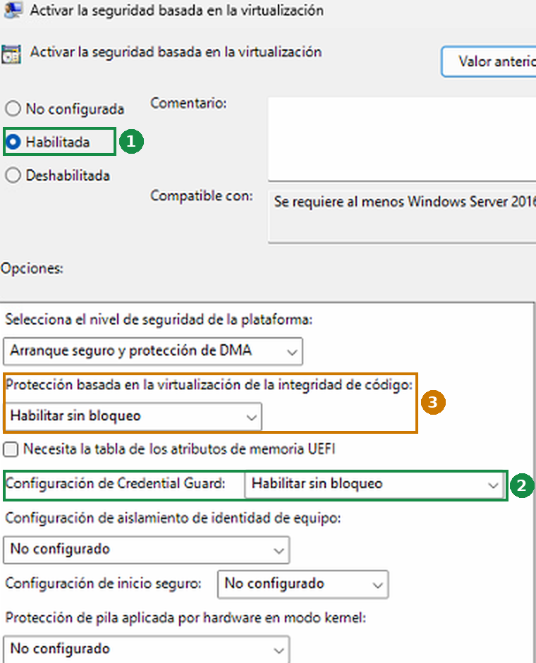

# NTLM Check

**Test-NtlmHardening.ps1 · v1.1.0 · by [mainmind.com](https://mainmind.com)**

[🇪🇸 Español](README.md) · 🇬🇧 English

Windows diagnostic script that explains why a computer can no longer connect to an SMB file share (a NAS, a Samba server or a non-domain computer) with the error:

> Authentication failed because NTLM authentication has been disabled

It targets the change shipped in the **October 2026 cumulative update (KB5127648)**, but it also checks the other settings that produce the same message. It is **read-only**: it does not change the registry, policies or any service.

## The problem

Since the October 13, 2026 cumulative update (**KB5127648**, builds `26100.9711`, `26200.9711` and `26300.9711`), Windows 11 24H2, 25H2 and 26H2 and Windows Server 2025 switch the default behaviour of `BlockNtlmv1SSO` from *Audit* to *Enforce* when that value is not set in the registry **and Credential Guard is off** ([KB5066470](https://support.microsoft.com/help/5066470)).

Microsoft documents it as a change that may affect Wi-Fi, Ethernet and VPN using MS-CHAPv2. In practice it also breaks SMB access with explicit credentials to non-domain servers, **even when client and server negotiate NTLMv2**. The clues:

- Event **4015** in `Microsoft-Windows-NTLM/Operational`, with process `SYSTEM` (PID 4) and target `cifs/<server>`.
- `Get-SmbClientConfiguration` shows `BlockNTLM = False`, so the block does **not** come from the SMB client.
- It worked until the update was installed.

## Requirements

- Windows 10/11 or Windows Server with PowerShell 5.1 or later
- Recommended: run it as administrator (without elevation some event logs may not be readable)

## Download

```powershell
New-Item -ItemType Directory -Path C:\mainmind\NtlmCheck -Force | Out-Null
Invoke-WebRequest https://raw.githubusercontent.com/mainmind83/PowerShell/main/NtlmCheck/Test-NtlmHardening.ps1 -OutFile C:\mainmind\NtlmCheck\Test-NtlmHardening.ps1
Unblock-File C:\mainmind\NtlmCheck\Test-NtlmHardening.ps1
```

Read any script downloaded from the internet before running it.

## Usage

```powershell
cd C:\mainmind\NtlmCheck
powershell -ExecutionPolicy Bypass -File .\Test-NtlmHardening.ps1
```

If no target is given, the script asks for one and validates it: it accepts an FQDN, an IP address (v4 or v6) or a UNC path, and asks again if the input is not valid.

| Parameter | Description |
|---|---|
| `-Target <target>` | Server or file share: `nas.mydomain.local`, `192.168.1.20` or `\\nas.mydomain.local\data`. `//server/share` and `smb://server/share` are accepted too. |
| `-Lang es\|en` | Message language. If omitted, the Windows language is detected and a choice is offered (Enter accepts the detected one). |
| `-Days <1-90>` | Days of NTLM event history to review. Default 7. |

Exit code: `0` when there are no failures and `1` otherwise, so it can run from an RMM with `-Target` and `-Lang` (then it asks nothing).

## What it checks, step by step

1. **Target.** Validates the input, warns about short names (they depend on the DNS suffix) and IP addresses (Windows never uses Kerberos against an IP), resolves the name and tests TCP port 445. If this fails, the problem is network, DNS, VPN or firewall, not NTLM.
2. **Windows version.** Build and UBR, and whether it already includes the October 2026 cumulative update. Shows the KB5127648 install date when it is listed.
3. **Credential Guard.** Whether it is running in the current boot, based on **Wininit event 13**. It does not rely on WMI alone: `Win32_DeviceGuard.SecurityServicesRunning` can return a false `0` while Credential Guard is running. Shows where the configuration comes from (policy, `Lsa\LsaCfgFlags`, `Scenarios\CredentialGuard`) and warns when virtualization-based security is **disabled by policy** or when tweaking tools left leftovers behind.
4. **BlockNtlmv1SSO.** The effective mode: *Enforce* by default, forced *Audit* (`0`), explicit *Enforce* (`1`) or "not applicable" when Credential Guard is running.
5. **LAN Manager authentication level** (`LmCompatibilityLevel`). Fails if the client may send LM/NTLMv1.
6. **SMB client NTLM blocking** (`BlockNTLM`, local and by policy) and whether the target is in the exception list.
7. **LSA outgoing NTLM restriction** (`RestrictSendingNTLMTraffic`) and its exceptions.
8. **NTLM events towards the target.** Correlates events **4015** (blocks) and **4020** (authentications, with the negotiated version) from the last few days. Tells "blocked now" apart from "there were blocks, but a later authentication succeeded".
9. **Network drives and SMB sessions with the target.** Lists the drives mapped to that server (`net use`) with their status and fails if any was created with `-BlockNTLM`, a block that applies to that mapping only and does not show in the global setting. Shows open sessions with dialect, credential, signing and encryption, and whether a credential is saved for the server. Two things to keep in mind: Windows closes idle sessions, so it is normal to see mapped drives and no session until you open the drive; and an open session does not re-authenticate, so to test a change you have to disconnect and reconnect. From an administrator console, drives mapped without elevation may not be visible.

At the end it shows a **summary**, a **diagnosis with the likely cause** and **next steps computed from what it found**.

## How to fix it

In order of preference:

1. **Enable Credential Guard.** This is Microsoft's recommendation, and the KB5066470 change does not apply while it runs. It is set in `gpedit.msc` → *Computer Configuration* → *Administrative Templates* → *System* → *Device Guard* → *Turn On Virtualization Based Security* (screenshot from a Spanish Windows).

    

    1. **Enabled.**
    2. **Credential Guard Configuration: Enabled without lock.** This is the setting that solves this problem. "Without lock" lets you turn it off later from the policy itself; "with UEFI lock" pins it in the firmware.
    3. **Virtualization Based Protection of Code Integrity.** Easy to confuse with the previous one, but it is a different feature (HVCI or "memory integrity"): it blocks drivers that do not meet its requirements and is the one that usually clashes with old drivers and some games' anti-cheat. It is not needed for this problem. If the computer has no issues, leave it *Enabled without lock*, as in the screenshot; if it does, set it to *Disabled* and keep Credential Guard.

    In *Select Platform Security Level*, *Secure Boot* works on any computer with Secure Boot; *Secure Boot and DMA Protection* adds protection against DMA attacks if the hardware supports it.
2. **`BlockNtlmv1SSO = 0`** in `HKLM\SYSTEM\CurrentControlSet\Control\Lsa\MSV1_0`, only if Credential Guard is not viable. It restores the pre-hardening behaviour for the **whole computer** and Microsoft frames it as temporary: document it as a decision, not as a fix.

Either way: reboot, disconnect the existing drive or session and reconnect so it authenticates again. Then run the script again.

What does **not** fix this case: `Set-SmbClientConfiguration -BlockNTLM $false` (it is already `False`), enabling insecure guest logons, or lowering the LAN Manager level. The last one weakens security and does not help anyway.

On the server side, take the chance to require **NTLMv2 only** and **SMB 2/3 as the minimum**.

## Known limitations

- It reads events in the format Windows writes them, which on the tested versions is English even on a Spanish system. Events that cannot be parsed are ignored rather than reported as false positives.
- October update detection uses the build and UBR (`.9711`). Any later cumulative update also matches.
- If the target is given as an IP and Windows logged the blocks with the name (or the other way round), step 8 may not correlate them. Use the same form you connect with.
- The link between `BlockNtlmv1SSO` and SMB access over NTLMv2 is a field observation, not something Microsoft documents.

## References

- [KB5066470 · NTLMv1 changes in Windows 11 24H2 and Windows Server 2025](https://support.microsoft.com/help/5066470)
- [KB5127648 · October 2026 cumulative update](https://support.microsoft.com/help/5127648)
- [NTLM logging and blocking](https://aka.ms/ntlmlogandblock)
- [Credential Guard](https://learn.microsoft.com/windows/security/identity-protection/credential-guard/)

## Version history

| Version | Changes |
|---|---|
| 1.1.0 | Step 9 extended: network drives mapped to the target with their status, detection of mappings created with `-BlockNTLM`, session credential and saved credentials; explains why there may be no session while drives are connected. Credential Guard instructions with the exact policy names and an annotated screenshot. |
| 1.0.0 | Initial release: target prompt and validation (FQDN, IP or UNC), 9 checks, computed diagnosis and next steps, bilingual (es/en), exit code for RMM use. |

## License

MIT, like the rest of the repository.
